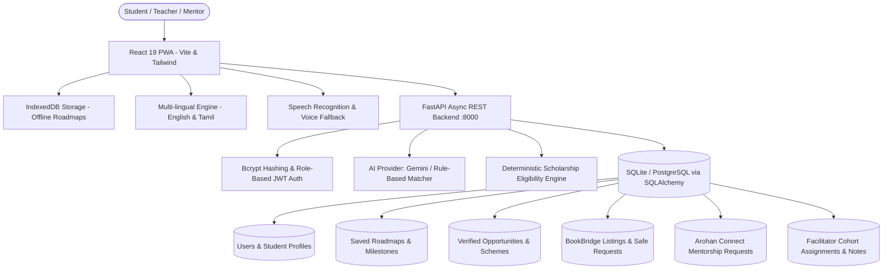

# AROHAN AI (ஆரோகன் AI)

> **Tagline:** *Every dream deserves a pathway.*  
> **Mission:** Empower rural Indian students to discover their strengths, explore realistic career pathways, access verified educational and financial opportunities, and take practical next steps toward economic independence.

[](https://fastapi.tiangolo.com)
[](https://react.dev)
[](https://www.typescriptlang.org)
[](https://tailwindcss.com)
[](https://docs.pytest.org)
[](https://vitest.dev)
[](https://developer.mozilla.org)

---

## 1. System Overview & The 5-Step Student Journey

AROHAN AI is built specifically for rural Indian students across **Classes 9–10, Classes 11–12, Undergraduates, and Graduates**, as well as their **teachers, community facilitators, and mentors**.

```
[1. Discover]      -> Complete 6-step questionnaire reflecting on natural interests & strengths
[2. Compare]       -> Compare diverse realistic pathways (Academic, Technical, Agri, Vocational, Civil)
[3. Build Roadmap] -> Generate phased milestones with estimated durations, skills, and verified source links
[4. Find Support]  -> Source-linked scholarships (NSP, PM-YASASVI) + Free textbooks via BookBridge
[5. Take Action]   -> Weekly progress tracking + Safe, platform-mediated Arohan Connect mentorship
```

---

## 2. Core Architecture & Tech Stack



- **Frontend:** React 19, TypeScript, Vite, Tailwind CSS, Lucide accessible icons.
- **Backend:** Python 3.12, FastAPI, Pydantic v2 schemas, PyJWT, Bcrypt.
- **Database:** SQLAlchemy ORM with automatic table creation and seed data (SQLite by default for zero-setup local dev; PostgreSQL supported via `DATABASE_URL`).
- **AI Architecture:** Pluggable AI Provider (`GeminiProvider` with backend-only key + `RuleBasedDemoProvider` deterministic fallback).
- **Offline / Low Bandwidth:** Service Worker app-shell caching + IndexedDB roadmap persistence.
- **Regional Languages:** Bilingual English and Tamil interface (`en` / `ta`).
- **Accessibility:** Accessible contrast, High Contrast Mode toggle, text scaling (`normal`, `large`, `xl`).

---

## 3. Instant Pre-Seeded Test Accounts

The application automatically seeds clearly labeled hackathon sample data on first startup. These personas and transactions are illustrative, not real student records. You can sign in immediately using any of these roles:

| Role | Email | Password | Persona & Key Permissions |
|---|---|---|---|
| **Student** | `student@arohan.org` | `student123` | **Kavitha Selvam** (Class 10, Thanjavur). Has active roadmap, pre-populated profile, and BookBridge requests. |
| **Teacher** | `teacher@arohan.org` | `teacher123` | **S. Sundaram** (Govt Higher Secondary). Can view assigned students, track progress, and record guidance notes. |
| **Mentor** | `mentor@arohan.org` | `mentor123` | **Dr. Anand Krishnan** (Verified STEM mentor). Can review and accept incoming student guidance requests. |
| **Book Donor** | `donor@arohan.org` | `donor123` | **Meera Ramanathan** (Community Book Donor). Can list school/college textbooks and approve student requests. |

> *Tip: Click any of the one-tap quick-fill buttons inside the Login modal to test immediately. The persistent **HACKATHON DEMO** notice labels sample profiles and transactions; official schemes link to their portals, while the sample grant is marked Demo.*

### Hackathon Demo Walkthrough

1. Sign in as **Student**. The seeded profile shows Class 10, rural location, interests, and scholarship-relevant preferences.
2. Open **Explore Careers**. Recommendations are rule-based in demo mode and show why each route matches, prerequisites, estimated cost, uncertainty, next action, and source references.
3. Choose **Build & Save Personalized Roadmap**. The selected pathway and category are saved once; the seeded software roadmap is already available for a quick progress demo.
4. Open **Opportunities**. Use **View Details & Requirements** to show the official NMMSS, SWAYAM, PM-YASASVI, and NAPS source/application links. These are external websites and may change their requirements.
5. Open **BookBridge** → **My Requests**. A fresh database includes a pending request whose note starts with `[HACKATHON SAMPLE]`. To demonstrate the full transaction, sign in as **Book Donor**, approve it, then return to the student account.
6. Sign in as **Teacher** → **Teacher Portal** → select Kavitha. Show the assigned student's profile, roadmap progress, and facilitator guidance record.

The seed endpoint is intentionally idempotent: if `student@arohan.org` already exists, it reports `already_seeded` and changes nothing. It is not a database reset. On an existing installation created before the sample request was added, submit a BookBridge request in the UI and prefix its note with `[HACKATHON SAMPLE]`; this preserves existing records.

---

## 4. Local Installation & Startup Guide

### Prerequisites
- Python 3.10+ (Tested on Python 3.12)
- Node.js 18+ (Tested on Node 20 & 24)
- npm (Node Package Manager)

### Step 1: Clone and Navigate
```powershell
cd c:\Users\arjun\Documents\AROHA-AI
```

### Step 2: Backend Setup
```powershell
# Create virtual environment
python -m venv backend/venv

# Activate virtual environment
.\backend\venv\Scripts\Activate.ps1

# Install backend dependencies
python -m pip install -r backend/requirements.txt

# Start FastAPI development server (runs on http://localhost:8000)
python -m uvicorn app.main:app --host 0.0.0.0 --port 8000 --reload --app-dir backend
```

*The backend will automatically create SQLite database tables and seed verified opportunities, sample textbooks, mentors, and test accounts on first launch.*

### Step 3: Frontend Setup (Open a second terminal)
```powershell
cd c:\Users\arjun\Documents\AROHA-AI\frontend

# Install dependencies
npm.cmd install

# Start Vite dev server (runs on http://localhost:5173)
npm.cmd run dev
```

Open your browser at **http://localhost:5173**.

---

## 5. Running Automated Tests

### Backend Test Suite (Pytest)
```powershell
c:\Users\arjun\Documents\AROHA-AI\backend\venv\Scripts\python.exe -m pytest backend/tests -v
```
**Test Coverage (14 Passed):**
- `test_health_check`: API & DB connectivity
- `test_auth_login_seeded_student`: Student authentication
- `test_auth_login_invalid_password`: Security credential rejection
- `test_auth_register_and_me`: User registration and JWT identity
- `test_public_registration_cannot_assign_privileged_roles`: Blocks self-assignment of privileged roles
- `test_seeded_hackathon_book_request`: Confirms the sample BookBridge request is visible to the student
- `test_student_profile_update`: 6-step questionnaire persistence
- `test_ai_career_recommendation`: Structured pathway generation & demo mode flag
- `test_ai_chat_interaction`: Conversational AI advisor with suggested actions
- `test_roadmap_creation_and_step_toggle`: Sequential milestone progress recalculation
- `test_opportunities_search_and_eligibility`: Deterministic scholarship eligibility check
- `test_bookbridge_listing_and_request`: Safe textbook donation lifecycle
- `test_arohan_connect_mentorship`: Youth-protected mentorship request
- `test_facilitator_role_authorization`: Role-based access control (RBAC) guard

### Frontend Test Suite (Vitest)
```powershell
cd frontend
npm.cmd test
```
**Test Coverage (9 Passed):**
- `renders landing page with headline and tagline`
- `renders 5-step journey sequence on the landing page`
- `toggles language between English and Tamil`
- `navigates to Opportunities directory with search`
- `navigates to BookBridge directory with donation modal`
- `navigates to Arohan Connect with minor safeguarding banner`
- `routes a teacher login to the teacher portal`
- `opens registration mode when Register is selected after closing Login`
- `clearly labels seeded sample data in the application shell`

### Production Build Verification
```powershell
cd frontend
npm.cmd run build
```
*(Compiled client bundle in under 1 second with 0 errors).*

---

## 6. Key Features & Rural Student Considerations

### A. Grounded Career Discovery (Screens D, E, F)
- Synthesizes student preferences without treating marks, family income, or rural geography as limits on potential.
- Generates 3–4 diverse pathways spanning technical, vocational, public-service, agricultural, and creative routes.
- Clearly states: **Why it matches**, **Prerequisites**, **Transparent costs**, **What remains uncertain**, and **Next action**.
- Compare Drawer: Side-by-side comparison of up to 3 pathways simultaneously.

### B. Verified Opportunities Directory & Deterministic Eligibility (Screens H, I)
- Source-linked records from official portals:
  - **National Means-cum-Merit Scholarship Scheme (NMMSS)** (Ministry of Education)
  - **SWAYAM Free Online Courses & Credit Transfer** (AICTE / NPTEL)
  - **PM-YASASVI Post-Matric Scholarship** (Ministry of Social Justice)
  - **National Apprenticeship Promotion Scheme (NAPS)** (MSDE)
- **Deterministic Eligibility Engine:** Evaluates education level, income thresholds, and state criteria with clear explanations instead of LLM hallucinations.
- Clear distinction between verified official schemes and sample demonstration records.

### C. BookBridge Educational Textbook Sharing (Screen J)
- Enables students and donors to list and request textbooks (NCERT, State Board, NEET/JEE, TNPSC).
- **Privacy by Design:** Home addresses and phone numbers are never collected or shown. Handover occurs via public collection points (Local Panchayat Libraries and Government School Hubs).
- Strictly free: Resale and commercial payments are excluded.

### D. Arohan Connect Mentorship (Screen K)
- Profiles of verified mentors with rural educational roots.
- **Youth Protection Protocol:** All communication is platform-mediated. Unsupervised offline meetings between minors and unknown adults are restricted.

### E. Teacher & Facilitator Portal (Screen M)
- Authorized faculty can review only their assigned students.
- Track roadmap progress and record guidance notes.
- Link new students to their school cohort.

### F. Offline & Low-Bandwidth Support (PWA)
- Installable Web App metadata and Service Worker (`sw.js`).
- Uses **IndexedDB** (`ArohanOfflineDB`) to cache saved learning roadmaps for offline access during rural network disruptions.

---

## 7. AI Provider Configuration & Fallback Logic

AROHAN AI features a provider abstraction in `backend/app/services/ai_provider.py`:

```
┌──────────────────────────────────────────────┐
│             AI Provider Factory              │
└──────────────────────┬───────────────────────┘
                       │
       ┌───────────────┴───────────────┐
       ▼                               ▼
[Gemini Provider]            [Rule-Based Demo Provider]
(If GEMINI_API_KEY is set)   (Zero-credential deterministic engine)
```

1. **Live Gemini Mode:** If `GEMINI_API_KEY` is provided in `.env`, Arohan calls Google Gemini 1.5 Flash using strict Pydantic schemas.
2. **Transparent Demo Mode:** If keys are unconfigured, Arohan uses its rule-based matching engine grounded in Indian educational curriculums. The response is explicitly labeled with `is_demo_mode: True` so users are never misled.

### External Integrations & Credentials

- **Gemini recommendations/chat:** `GEMINI_API_KEY` is required for live Gemini calls. Set `AI_PROVIDER=auto` or `gemini`; without the key the app uses the deterministic rule-based demo provider. No AI key is needed for the hackathon flow above.
- **OpenAI:** `OPENAI_API_KEY` appears in environment templates but is not currently used by the provider factory. Setting it alone does not enable OpenAI.
- **Voice:** The current voice modal uses the browser Web Speech API and requires a supported browser plus microphone permission. It does not call BHASHINI.
- **BHASHINI:** `BHASHINI_API_KEY`, `BHASHINI_USER_ID`, and `BHASHINI_PIPELINE_ID` are placeholders only; a BHASHINI API client is not wired into this version. Credentials alone will not activate it.
- **Opportunity portals:** Links open official public websites and require no app credentials. Internet access is needed to verify live application availability.
- **PostgreSQL:** Optional for deployment through `DATABASE_URL`; local demo defaults to SQLite.
- **Demo notice:** Set `VITE_DEMO_MODE=false` only when sample-data labeling should be hidden outside a hackathon/demo deployment.

---

## 8. Docker Deployment

Deploy the complete stack (PostgreSQL, FastAPI Backend, and Nginx Frontend) using Docker Compose:

```bash
# Copy and configure environment variables
cp .env.example .env

# Build and launch all services
docker-compose up --build -d

# Verify containers are running
docker-compose ps
```

- **Frontend Application:** http://localhost:3000
- **FastAPI API Documentation:** http://localhost:8000/docs
- **Health Endpoint:** http://localhost:8000/api/v1/health

---

## 9. Limitations & Production Considerations

- **Speech Recognition:** Web Speech API is utilized for browser-level speech-to-text. Integrating government-supported BHASHINI APIs will provide enhanced regional accent recognition in production.
- **Mentor Identity Verification:** In production, institutional email or DigiLocker verification should be linked before issuing the "Verified Mentor" badge.
- **Legal Compliance:** Platform terms and student data retention policies should undergo formal legal audit before statewide public deployment.

---

## 10. Project Directory Structure

```
AROHA-AI/
├── backend/
│   ├── app/
│   │   ├── api/             # REST endpoints (auth, students, ai, roadmaps, opportunities, books, mentors, facilitator, health)
│   │   ├── services/        # AI provider, career matcher, eligibility engine, seed data
│   │   ├── config.py        # Pydantic settings & env management
│   │   ├── database.py      # SQLAlchemy session & Base
│   │   ├── models.py        # Database models (User, Profile, Roadmap, Book, Mentor, Facilitator)
│   │   ├── schemas.py       # Pydantic v2 schemas
│   │   ├── security.py      # Bcrypt hashing & PyJWT authorization
│   │   └── main.py          # FastAPI app entrypoint & lifespan
│   ├── tests/               # Pytest automated test suite (14 tests)
│   ├── requirements.txt     # Python dependencies
│   └── .env.example         # Backend environment template
├── frontend/
│   ├── public/              # PWA manifest.json & Service Worker sw.js
│   ├── src/
│   │   ├── components/      # Accessible UI components (Navbar, MobileBottomNav, VoiceModal)
│   │   ├── context/         # Auth, Language (i18n), Accessibility, Offline contexts
│   │   ├── i18n/            # English and Tamil translations dictionary
│   │   ├── services/        # REST api client & IndexedDB offlineStorage
│   │   ├── types/           # TypeScript domain interfaces
│   │   ├── views/           # All 15 required screens & dashboards
│   │   ├── App.tsx          # Main application shell
│   │   └── main.tsx         # React root
│   ├── tailwind.config.js   # Arohan design tokens
│   └── package.json         # Frontend dependencies & Vitest test runner
├── docker-compose.yml       # Production Docker configuration
├── Dockerfile.backend       # Python 3.12 slim container
├── Dockerfile.frontend      # Multi-stage Node + Nginx container
├── nginx.conf               # Nginx reverse proxy & SPA router
└── README.md                # Project documentation
```
